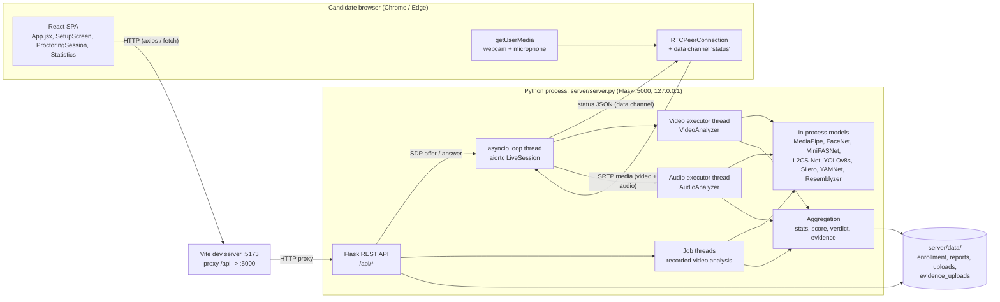
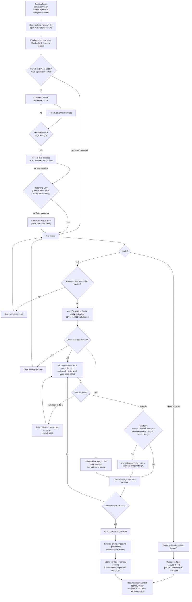
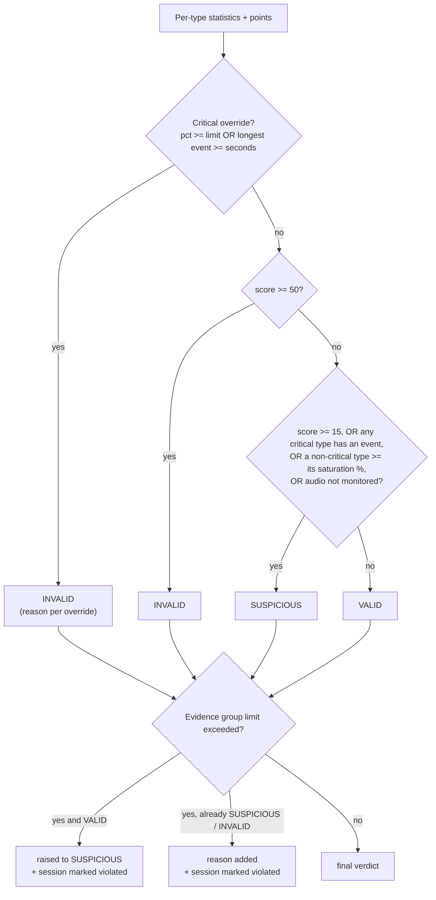
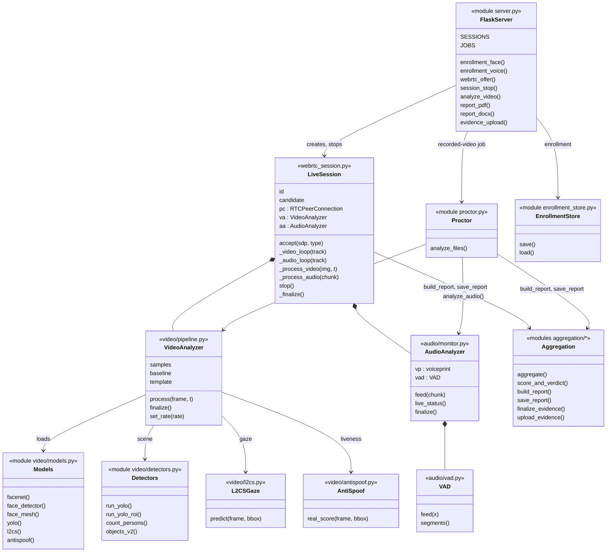
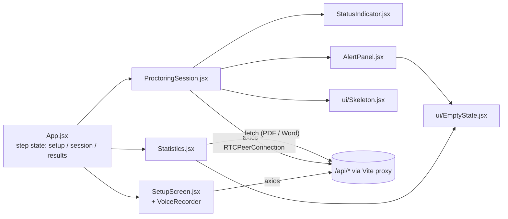
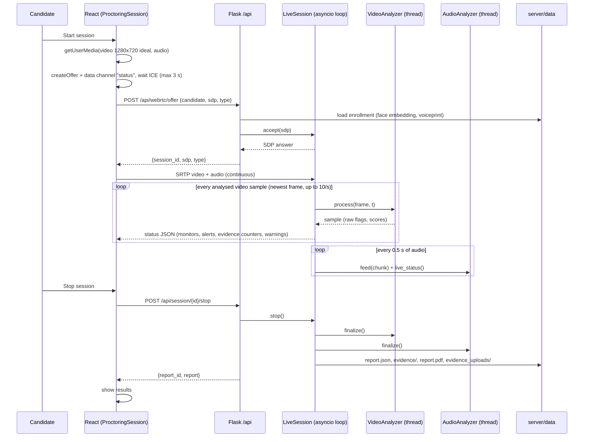
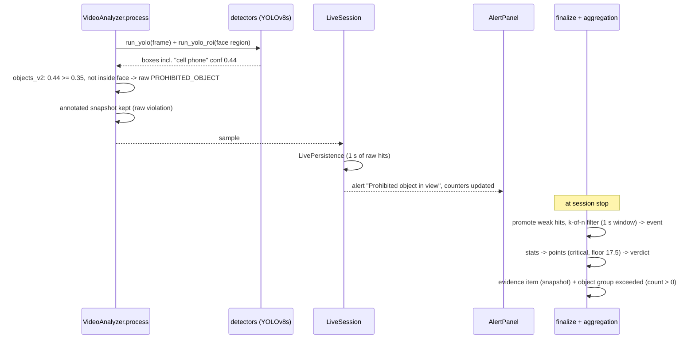
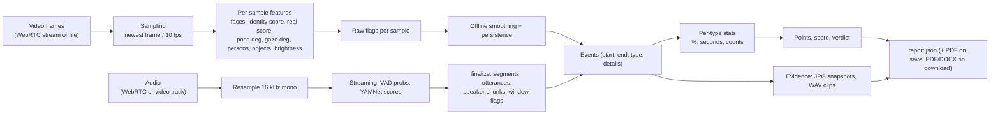

# Multimodal Online Examination Proctoring System — Technical Explanation

> Architecture reference, model and scoring explanation, API reference and local development guide.
> Every statement below was checked against the source code in this repository (October 2026).
> Source references are given as `path:function` or `path` next to the claims.
> Anything that could not be established from the code is marked **Not verified in source code**.
>
> **Quick start (Windows):** `powershell -ExecutionPolicy Bypass -File .\start-all.ps1`, then use the app at
> `http://localhost:5173` (details in [Section 14](#14-clone-and-run-the-project)).
>
> **Further documentation in this repository**:
> - `flow.txt` PART II (sections A–E): the detailed design and decision record for every step, threshold and endpoint.
> - `plan.md`: what was changed and why, with the status table, action log and accuracy log.
> - `server/config.py`: the single source of all thresholds and weights.

## Table of Contents

1. [Project Overview](#1-project-overview)
2. [Features and Functional Scope](#2-features-and-functional-scope)
3. [Complete Repository Structure](#3-complete-repository-structure)
4. [High-Level Architecture](#4-high-level-architecture)
5. [End-to-End System Workflow](#5-end-to-end-system-workflow)
6. [AI/ML Models and Detection Algorithms](#6-aiml-models-and-detection-algorithms)
7. [Scoring Methodology and Suspicious Activity Assessment](#7-scoring-methodology-and-suspicious-activity-assessment)
8. [Low-Level Design (LLD)](#8-low-level-design-lld)
9. [Data Flow and Sequence Diagrams](#9-data-flow-and-sequence-diagrams)
10. [API and Communication Documentation](#10-api-and-communication-documentation)
11. [Data Models and Persistence](#11-data-models-and-persistence)
12. [Technology Stack and Dependencies](#12-technology-stack-and-dependencies)
13. [Prerequisites and Environment Setup](#13-prerequisites-and-environment-setup)
14. [Clone and Run the Project](#14-clone-and-run-the-project)
15. [Configuration, Ports, and Service Connectivity](#15-configuration-ports-and-service-connectivity)
16. [Testing and Verification](#16-testing-and-verification)
17. [Troubleshooting](#17-troubleshooting)
18. [Security, Privacy, and Limitations](#18-security-privacy-and-limitations)
19. [Summary and Future Improvements](#19-summary-and-future-improvements)

---

## 1. Project Overview

### Purpose and problem statement

Remote examinations can be compromised in ways a human invigilator would normally notice:
- someone else sits the exam (impersonation), or the candidate presents a photo or screen instead of a live face (spoofing);
- a second person is present, or a phone, book, laptop or extra screen is used;
- the candidate repeatedly looks or turns away from the screen;
- the candidate talks, whispers or listens to another voice, or there are suspicious sounds (phone ringing, music, TV).

This project monitors a candidate's **webcam and microphone** during an exam, detects these behaviours with computer-vision and audio models, and produces a **scored, evidence-backed report** (JSON, PDF, Word) that a human reviewer can act on.

### Inputs, processing and outputs

| Stage | What happens |
|---|---|
| **Inputs** | A reference face photo and a 25 s voice recording (enrollment); then either a **live** webcam + microphone stream (WebRTC) or an **uploaded exam video** (with its audio track). |
| **Processing** | Server-side Python pipeline: face detection and verification, anti-spoofing, head pose, eye gaze, person and object detection (video, sampled up to 10 frames/s); voice activity, speaker verification, whispering and sound-event detection (audio). Per-sample flags are smoothed, filtered for persistence and turned into time-stamped events. |
| **Outputs** | A report with per-violation statistics, a 0–100 violation score, a verdict (VALID / SUSPICIOUS / INVALID) with reasons, a timeline, evidence (annotated snapshots, WAV clips), session-violation counters and PDF / Word exports. |

### Intended users and use cases

- **Candidates**: enroll their face and voice, then take a proctored test (live) — `client/proctoring/src/components/SetupScreen.jsx`, `ProctoringSession.jsx`.
- **Invigilators / reviewers**: read the results page, download PDF / Word / JSON reports and review evidence — `Statistics.jsx`, `server/aggregation/*`.
- **Offline review**: analyse an already recorded exam video, from the UI or the command line (`server/app.py`).

### Key architectural characteristics

- **Two processes**: a React single-page app (Vite dev server, port 5173) and **one** Python Flask server (port 5000) that also runs the WebRTC endpoint and all models in-process. There is no separate inference service, no database and no message broker.
- **Media is analysed server-side.** In live mode, the browser streams camera and microphone to the Python server over WebRTC (`aiortc`); per-sample status flows back over a WebRTC data channel.
- **File-based persistence** under `server/data/` (enrollment references, reports, evidence).
- **Single configuration module** (`server/config.py`) holds every threshold, weight and switch. It has two profiles: `v2` (active) and `legacy` (reproduces the original v1 app for regression).
- **CPU-only inference** (PyTorch CPU build; no CUDA path is used).

### Current implementation status

All features in Section 2 marked *Implemented* exist in the code and are wired end to end. Important caveats:
- **Test results are historical.** The recorded automated test results (`server/tests/results/SUMMARY.md`, dated 2026-10-14 18:23) **predate** several later changes:
  - L2CS-Net gaze, MiniFASNet anti-spoofing and 10 fps sampling;
  - the voice-rule changes and the new scoring.
  
  Those results therefore do not cover the current code (see Section 16).
- **Several accuracy figures come from simulations or small samples**, and the code comments say so: speaker thresholds on LibriSpeech with a simulated channel, and anti-spoof real-face scores on a handful of images.
- **Not measured:** attack recall for anti-spoofing, and live end-to-end accuracy.

---

## 2. Features and Functional Scope

| Feature | Purpose | Implementation Status | Source Files |
|---|---|---|---|
| Candidate onboarding with consent | Candidate ID + explicit consent before any biometric data is stored | Implemented | `client/.../SetupScreen.jsx`, `server/server.py:enrollment_face` |
| Reference-face enrollment | Store a reference photo + FaceNet embedding (rejects 0 / >1 faces, tiny faces) | Implemented | `server/server.py:enrollment_face`, `server/video/face.py:reference_from_image`, `server/enrollment_store.py` |
| Voice enrollment (voiceprint) | 25 s read-aloud passage → speech length / level / SNR / clipping / consistency checks → Resemblyzer voiceprint; max 3 attempts | Implemented | `server/server.py:enrollment_voice`, `server/audio/enrollment.py:evaluate_recording`, `server/audio/speaker.py:voiceprint` |
| Passage word-match check (ASR) | Compare a Vosk transcript with the passage | **Implemented but disabled** (`enroll.asr_enabled = False`) | `server/audio/asr.py` |
| Webcam / microphone initialisation | `getUserMedia` with permission-error handling, secure-context check, recorder fallback | Implemented | `SetupScreen.jsx:VoiceRecorder`, `ProctoringSession.jsx:startLive` |
| Live streaming to the server | Browser → server WebRTC (video + audio); status back on a data channel | Implemented | `ProctoringSession.jsx`, `server/webrtc_session.py:LiveSession` |
| Recorded-video analysis | Upload a video; background job with progress polling | Implemented | `server/server.py:analyze_video`, `server/proctor.py:analyze_files` |
| Face detection / presence | MediaPipe face detection; `FACE_NOT_VISIBLE` violation | Implemented | `server/video/face.py:detect_faces`, `server/video/pipeline.py` |
| Identity verification | FaceNet embedding vs reference (cosine ≥ 0.415) with majority vote | Implemented | `server/video/face.py:compare`, `pipeline.py:_flag_identity` |
| Face anti-spoofing | MiniFASNet real-face score; `FACE_SPOOF` violation | Implemented (attack recall not measured) | `server/video/antispoof.py`, `server/video/minifasnet.py`, `pipeline.py:_flag_spoof` |
| Facial landmarks + head pose | MediaPipe Face Mesh; person-specific landmark template (Kabsch) with PnP for calibration | Implemented | `server/video/head_pose.py`, `pipeline.py:_flag_pose` |
| Eye gaze | L2CS-Net (ResNet50, Gaze360) yaw/pitch vs calibrated forward gaze; iris-landmark fallback | Implemented | `server/video/l2cs.py`, `server/video/gaze.py`, `pipeline.py:_flag_gaze_l2cs` |
| Multiple-person detection | YOLOv8s persons fused with MediaPipe faces; photo/poster rejection; arm/hand rejection | Implemented | `server/video/detectors.py:count_persons`, `pipeline.py:_mark_static_faces` |
| Prohibited-object detection | YOLOv8s COCO classes: cell phone, book, laptop, tv ("extra screen"), plus a second pass around the face | Implemented | `server/video/detectors.py:objects_v2, run_yolo_roi` |
| Low-light warning | Warn when the image is too dark (live and report) | Implemented | `pipeline.py:process` (brightness), `webrtc_session.py`, `aggregation/report.py` |
| Voice activity detection | Silero VAD (webrtcvad fallback) with high-pass filter, SNR and YAMNet confirmation | Implemented | `server/audio/vad.py`, `server/audio/monitor.py:validate_segments` |
| Speaker verification / multiple speakers | Resemblyzer d-vectors vs enrollment + session-adapted print | Implemented | `server/audio/monitor.py`, `server/audio/speaker.py` |
| Whispering / suspicious sounds | YAMNet categories + voicing cue | Implemented | `server/audio/yamnet.py`, `server/audio/monitor.py:_raw_flags` |
| Real-time alerts | Live monitors, alerts, counters, warnings pushed per sample | Implemented | `webrtc_session.py:_process_video/_process_audio`, `AlertPanel.jsx` |
| Risk scoring and verdict | Points per violation (severity-based), critical overrides, verdict with explanations | Implemented | `server/aggregation/aggregate.py`, `server/config.py:aggregation` |
| Evidence package + session violation | Snapshots / WAV clips per group; percentage or count limits; local evidence "upload" | Implemented | `server/aggregation/evidence.py` |
| Reports (JSON / PDF / Word) | Report on disk; PDF and DOCX built on download | Implemented | `server/aggregation/report.py`, `pdf_report.py`, `docx_report.py` |
| Report listing API | List stored reports | Implemented (API only; no UI page uses it) | `server/server.py:reports_list` |
| Authentication / authorization | — | **Not implemented** | — |
| Database | — | **Not implemented** (file storage only) | — |
| Exam content / questions | — | **Not implemented** (the app proctors; it does not deliver an exam) | — |
| Screen / tab-switch monitoring | — | **Not implemented** | — |
| Earphone detection | — | **Not implemented** (not a COCO class; noted in `config.py` comment) | — |

---

## 3. Complete Repository Structure

Virtual environments (`.venv/`, `venv/`), `node_modules/`, build output, caches and personal data are omitted.

```text
Online-Proctoring-System/
├── README.md                     This document
├── flow.txt                      Detailed design / decision document (PART II = current system)
├── plan.md                       Status table + chronological action log + accuracy log
├── start-all.ps1                 Opens backend + frontend in two PowerShell windows, waits for /api/health
├── start-backend.ps1             Checks/installs Python deps, downloads model weights, runs server/server.py
├── start-frontend.ps1            npm install if needed, then npm run dev
├── client/proctoring/            React frontend (Vite)
│   ├── package.json              Scripts: dev, build, lint, preview
│   ├── vite.config.js            Dev proxy /api -> http://localhost:5000
│   ├── tailwind.config.js        Design tokens (palette, fonts, shadows, animations)
│   ├── eslint.config.js          ESLint 9 flat config
│   ├── index.html                Root page; applies saved light/dark theme before first paint
│   └── src/
│       ├── main.jsx              React entry point
│       ├── App.jsx               App shell: header, step indicator, theme toggle, step state machine
│       ├── index.css             Design system (CSS variables, glass components, states)
│       └── components/
│           ├── SetupScreen.jsx       Enrollment: consent, reference photo, voice recording
│           ├── ProctoringSession.jsx Test: live WebRTC session or recorded-video upload
│           ├── Statistics.jsx        Results: verdict, scoring, charts, evidence, downloads
│           ├── AlertPanel.jsx        Live alert list
│           ├── StatusIndicator.jsx   Connection / calibration pills
│           ├── index.js              Barrel exports
│           └── ui/Skeleton.jsx, ui/EmptyState.jsx   Loading and empty-state components
└── server/                       Python backend (Flask + aiortc + models)
    ├── server.py                 Flask app: REST API, WebRTC signalling, recorded-video jobs, reports
    ├── webrtc_session.py         LiveSession: receives WebRTC tracks, runs analyzers, pushes status
    ├── proctor.py                analyze_files(): offline video + audio -> report (used by jobs and CLI)
    ├── app.py                    Command-line entry point for offline analysis
    ├── config.py                 All thresholds, weights, switches; profiles "v2" and "legacy"
    ├── enrollment_store.py       Local storage of reference face / voiceprint / meta
    ├── requirements.txt          Pinned Python dependencies
    ├── video/
    │   ├── pipeline.py           VideoAnalyzer: per-sample pipeline, calibration, flags, finalize
    │   ├── models.py             Cached model loaders (FaceNet, MediaPipe, YOLO, L2CS, MiniFASNet)
    │   ├── face.py               Face detection, subject selection, FaceNet embedding, comparison
    │   ├── head_pose.py          solvePnP pose + person-specific template (Kabsch) pose
    │   ├── gaze.py               Iris-ratio gaze (fallback) + decision rules for both gaze methods
    │   ├── l2cs.py               L2CS-Net model, preprocessing, inference, weight download
    │   ├── antispoof.py          MiniFASNet wrapper, crop, real-face score, weight download
    │   ├── minifasnet.py         MiniFASNet architectures (vendored, Apache-2.0)
    │   ├── detectors.py          YOLO passes, person counting, object filtering
    │   └── temporal.py           Smoothing, persistence filters, sample-window helpers
    ├── audio/
    │   ├── monitor.py            AudioAnalyzer: VAD, YAMNet, speaker checks, raw flags, events
    │   ├── vad.py                Silero / webrtcvad voice activity detection
    │   ├── yamnet.py             YAMNet loading and category mapping
    │   ├── speaker.py            Resemblyzer embeddings and voiceprints
    │   ├── enrollment.py         Voice enrollment recording evaluation
    │   ├── quality.py            Level / SNR / clipping measurements and judgement
    │   ├── asr.py                Optional Vosk passage check (disabled by default)
    │   ├── passages.py           Reading passages for enrollment
    │   └── io.py                 Audio decoding (bundled ffmpeg), source status, recording helpers
    ├── aggregation/
    │   ├── aggregate.py          Per-type statistics, scoring, verdict, group percentages
    │   ├── denominators.py       Which samples count towards each violation type
    │   ├── events.py             Flags -> time-stamped events
    │   ├── evidence.py           Evidence package, counters, session violation, evidence store
    │   ├── report.py             Report assembly, saving (JSON + PDF), console summary
    │   ├── pdf_report.py         PDF export (reportlab)
    │   └── docx_report.py        Word export (python-docx)
    ├── models/                   Downloaded weights (git-ignored): l2cs/, antispoof/, tfhub/, vosk model
    ├── yolov8n.pt, yolov8s.pt, yolov8m.pt   YOLO weights (yolov8s is used; n = legacy profile; m was only compared)
    ├── data/                     Runtime data (git-ignored): enrollment/, reports/, uploads/, evidence_uploads/
    ├── legacy/                   v1 code kept for reference: app_v1.py, server_v1.py (Socket.IO), flow_v1.txt
    └── tests/                    Test scripts, calibration / evaluation scripts, results/
```

---

## 4. High-Level Architecture



**Component responsibilities**

| Component | Responsibility | Source |
|---|---|---|
| React SPA | Three-step UI (Enrollment → Test → Results), device access, WebRTC client, report rendering and downloads | `client/proctoring/src` |
| Vite dev server | Serves the SPA and proxies `/api` to the backend (development only) | `client/proctoring/vite.config.js` |
| Flask REST API | Enrollment, WebRTC signalling, session stop, recorded-video jobs, reports, evidence store | `server/server.py` |
| asyncio loop + `LiveSession` | Accepts the WebRTC offer, receives tracks, schedules analysis, sends status over the data channel | `server/webrtc_session.py` |
| `VideoAnalyzer` | Per-sample video pipeline and offline finalisation | `server/video/pipeline.py` |
| `AudioAnalyzer` | Streaming VAD + YAMNet, offline speaker / event analysis | `server/audio/monitor.py` |
| Aggregation | Statistics, scoring, verdict, evidence, report files | `server/aggregation/*` |
| File storage | Enrollment references, reports, evidence | `server/data/` |

**How data travels**

1. All REST calls go browser → Vite proxy → Flask over HTTP (JSON or multipart form data).
2. In live mode, the browser sends an SDP offer by HTTP (`POST /api/webrtc/offer`); the answer returns by HTTP. After that, **camera and microphone media stream continuously over WebRTC** (aiortc on the server).
3. The server pushes one JSON status message per analysed video sample over the WebRTC data channel named `status` (`webrtc_session.py:_send`).
4. Recorded videos are uploaded once (multipart), analysed in a background thread, and polled every second by the client.

**Where processing happens**: all video and audio analysis happens **server-side, in the Python process**. The browser only captures, displays and streams media, and renders results.

**Where state lives**
- **In memory:** `SESSIONS` and `JOBS` dictionaries in `server.py`, and the analyzers inside each `LiveSession`.
- **On disk:** enrollment, reports and evidence under `server/data/` (Section 11).

**Synchronous vs asynchronous**
- REST handlers are synchronous Flask handlers (`threaded=True`).
- WebRTC runs on a dedicated asyncio event loop thread. Coroutines are bridged from Flask with `run_async` (`asyncio.run_coroutine_threadsafe`).
- Model work runs in two single-thread executors per live session (video, audio).
- Recorded-video jobs run in daemon threads.

**Major dependencies and failure points**

| Failure point | What happens |
|---|---|
| Camera / microphone permissions | Client shows explicit error messages (`ProctoringSession.jsx:startLive`, `SetupScreen.jsx:micErrorText`). |
| WebRTC negotiation | The server answers 500 "WebRTC negotiation failed". A failed connection state shows "The WebRTC connection to the server failed." in the client. |
| Model loading | Failures are logged at start-up (`server.py:warm_models`). L2CS falls back to the iris gaze method; anti-spoofing is disabled. Both add a warning to the report. |
| CPU throughput | Live video uses a newest-frame policy: frames arriving while the analyzer is busy are dropped, so the achieved sample rate depends on the CPU (Section 6.13). |
| In-memory state | Sessions and jobs are lost if the server restarts. |

---

## 5. End-to-End System Workflow



**Stage-by-stage explanation**

| # | Stage | Input → Output | Responsible module | Failure behaviour |
|---|---|---|---|---|
| 1 | Backend start | — → Flask on 127.0.0.1:5000, asyncio loop thread; `warm_models` loads FaceNet, YOLO, L2CS, MiniFASNet | `server/server.py` | Model load errors are printed; L2CS/anti-spoof fall back or disable with report warnings |
| 2 | Frontend start | — → SPA at :5173 | `client/proctoring` | — |
| 3 | Candidate + consent | ID text, checkbox → enables steps 2–3 | `SetupScreen.jsx` | Steps stay disabled until both are set |
| 4 | Saved enrollment check | ID → `{face, voice, meta}` | `server.py:enrollment_status` | Treated as "not enrolled" on error |
| 5 | Face enrollment | Base64 JPEG → `face.jpg`, `face_embedding.npy`, `meta.json` | `server.py:enrollment_face`, `face.reference_from_image` | 400 with a message: no face, >1 face, face too small, no consent |
| 6 | Voice enrollment | Audio blob (webm/ogg/wav) → metrics + `voiceprint.npy` | `server.py:enrollment_voice`, `audio/enrollment.py` | Problems/warnings listed; 429 after 3 attempts; the raw recording is deleted |
| 7 | Session creation | SDP offer → session id + SDP answer | `server.py:webrtc_offer`, `LiveSession.accept` | 400 if not enrolled; 500 on negotiation failure |
| 8 | Acquisition / sampling | Video frames → newest frame every `1/fps` s; audio → 16 kHz mono, fed every 0.5 s | `webrtc_session.py:_video_loop/_audio_loop` | Busy analyzer → frames dropped (not queued) |
| 9 | Face detection + identity | Frame → faces, subject, cosine score, majority-voted identity | `pipeline.py:process`, `face.py` | No face → `FACE_NOT_VISIBLE` raw flag |
| 10 | Anti-spoofing | Subject face → real-face score, 1 s mean | `pipeline.py:_flag_spoof` | Model missing → not checked, report warning |
| 11 | Landmarks, pose, gaze | Face Mesh → pose (deg), L2CS gaze (deg) | `head_pose.py`, `l2cs.py`, `pipeline.py` | Mesh not matching the subject → no pose/gaze for the sample |
| 12 | Calibration | First 3 s (≥5 accepted, max 10 s) → baseline pose, head template, forward gaze | `pipeline.py:_calibration_add` | Fallback baseline after 10 s; gaze baseline collected later if gaze samples were implausible |
| 13 | Scene | Frame → persons, objects (YOLOv8s + ROI pass) | `pipeline.py:_flag_scene`, `detectors.py` | — |
| 14 | Audio processing | Audio → VAD probabilities, YAMNet scores, live speaker similarity | `audio/monitor.py`, `webrtc_session.py:_process_audio` | Silent source → warning `mic_silent` |
| 15 | Live debounce + alerts | Raw flags → confirmed flags (1 s), alerts, counters | `webrtc_session.py:_process_video` | — |
| 16 | Termination | Stop request → peer connection closed, executors drained | `LiveSession.stop` | 404 for unknown session; 500 if the report fails |
| 17 | Finalisation | Samples → smoothed flags, persistence-filtered events; full-session audio analysis | `pipeline.py:finalize`, `monitor.py:finalize` | — |
| 18 | Results | Stats → score, verdict, evidence, counters, files | `aggregation/*` | PDF failure is logged, never breaks the JSON report |

---

## 6. AI/ML Models and Detection Algorithms

Summary of the active (profile `v2`) pipeline:

| # | Module | Type | Model / algorithm |
|---|---|---|---|
| 6.1 | Face detection | Pretrained DL model, used directly | MediaPipe Face Detection, `model_selection=1` (full range) |
| 6.2 | Identity verification | Pretrained DL embedding + threshold | FaceNet via `keras-facenet` (Inception-ResNet-v1, weights `20180402-114759`) |
| 6.3 | Face anti-spoofing | Pretrained DL classifiers | MiniFASNetV2 + MiniFASNetV1SE (Silent-Face-Anti-Spoofing) |
| 6.4 | Landmarks | Pretrained DL model | MediaPipe Face Mesh (`refine_landmarks=True`, 478 points) |
| 6.5 | Head pose | Classical geometry | `cv2.solvePnP` 6-point model + person-specific 3D template aligned with Kabsch/SVD |
| 6.6 | Eye gaze | Pretrained DL regressor | L2CS-Net, ResNet50, Gaze360 weights (fallback: iris-landmark geometry) |
| 6.7 | Persons + objects | Pretrained DL detector + rules | Ultralytics YOLOv8s (COCO) + face fusion rules |
| 6.8 | Voice activity | Pretrained DL model + rules | Silero VAD (fallback: webrtcvad) |
| 6.9 | Sound events | Pretrained DL classifier | YAMNet (TF Hub `google/yamnet/1`) |
| 6.10 | Speaker verification | Pretrained DL embedding + rules | Resemblyzer `VoiceEncoder` (d-vectors) |
| 6.11 | Whispering | Model score + signal heuristic | YAMNet "Whispering" + autocorrelation voicing cue |
| 6.12 | Passage check (optional) | Pretrained ASR | Vosk `vosk-model-small-en-us-0.15` (**disabled**) |
| 6.13 | Temporal logic | Rule-based | Smoothing, hysteresis, persistence, calibration |

No model in this repository is trained or fine-tuned by the project. All learned models are third-party pretrained weights used for inference. The project's own logic is the pre/post-processing, thresholds, fusion rules and temporal filtering.

### 6.1 Face detection — MediaPipe Face Detection

- **Purpose**: find faces per sample; presence, subject selection, crops for identity / spoofing / gaze.
- **Library**: `mediapipe` 0.10.21 (`mp.solutions.face_detection`).
- **Variant**: `model_selection=1` (full-range model), `min_detection_confidence = face.det_confidence = 0.6` — `server/video/models.py:face_detector`.
- **Weights**: bundled inside the mediapipe wheel.
- **Input**: RGB frame (any size).
- **Output**: `[{"bbox": (x, y, w, h), "score"}]`, clamped to the frame; faces narrower than `min_face_px = 40` are dropped — `server/video/face.py:detect_faces`.
- **Post-processing**:
  - Subject selection (`face.select = "best_match"`): up to 3 largest faces are embedded and the most similar to the reference is chosen. Otherwise the largest face is used — `pipeline.py:_select_subject`.
  - Static faces (photos / posters) are tracked over `static_s = 3 s`: a face whose centre / width standard deviation is below 1% of its width is marked `static` and ignored for person counting — `pipeline.py:_mark_static_faces`.
- **Consumers**: identity, anti-spoofing, L2CS crop, person counting, `FACE_NOT_VISIBLE`.

### 6.2 Identity verification — FaceNet (keras-facenet)

- **Purpose**: is the person in front of the camera the enrolled candidate?
- **Library**: `keras-facenet` 0.3.2 on TensorFlow 2.15.1 — `server/video/models.py:facenet`, `embed_faces`.
- **Architecture / weights**: Inception-ResNet-v1 FaceNet, model key `20180402-114759` (the library default).
  - `keras-facenet` downloads `20180402-114759-weights.h5` from its GitHub release into `~/.keras-facenet/` on first use and checks it with SHA-256 (`keras_facenet/metadata.py`).
  - Library metadata: 512 dimensions, `distance_metric: cosine`, `image_size: 160`.
- **Input**: 160 × 160 RGB crop of the face box enlarged by `crop_margin = 0.30` per side — `face.py:crop_face`.
- **Preprocessing**: `FaceNet._normalize`. For this model `fixed_image_standardization = True`, so pixels become `(x − 127.5) / 127.5`.
- **Inference**: a compiled `tf.function` for speed — `models.py:_facenet_fn`.
- **Output**: 512-D L2-normalised embedding.
- **Decision**: cosine similarity with the reference ≥ `cos_threshold = 0.415` → match — `face.py:compare`. The value was chosen on LFW (`tests/calibrate_face_threshold.py`; flow.txt §A.7).
- **Post-processing**: majority vote over `vote_s = 1.6 s` of samples (`MajorityVote`), then raw flag `IDENTITY_MISMATCH` — `pipeline.py:_flag_identity`.
- **Limitation**: the threshold was calibrated on LFW photos, not on webcam footage of this population.

### 6.3 Face anti-spoofing — MiniFASNet

- **Purpose**: detect photo or screen-replay presentation attacks.
- **Library**: PyTorch (CPU). Architecture code vendored unchanged from `minivision-ai/Silent-Face-Anti-Spoofing` — `server/video/minifasnet.py` (Apache-2.0).
- **Models**: `2.7_80x80_MiniFASNetV2` (context scale 2.7) and `4_0_0_80x80_MiniFASNetV1SE` (scale 4.0).
  - The repository's `.pth` files are downloaded and checked against their git blob SHA-1, then loaded with `torch.load(weights_only=True)`.
  - They are stored as `.safetensors` in `server/models/antispoof/` — `server/video/antispoof.py:download`.
- **Input / preprocessing** (`antispoof.py:crop_box`, `AntiSpoof.real_score`):
  1. Crop `scale ×` the face box around its centre, shifted inside the frame.
  2. Resize to 80 × 80, in **BGR**.
  3. Convert to float **without** dividing by 255, as the upstream code does.
- **Inference**: both models; softmax over 3 classes; the softmaxes are summed; `real score = sum[1] / 2` (class 1 = real).
- **Decision**: mean real score over `antispoof.window_s = 1 s` < `real_thr = 0.5` → raw `FACE_SPOOF`. Offline, a centred mean is used — `pipeline.py:_flag_spoof`, `_recompute_spoof_offline`.
- **Persistence**: must last `persist_s = 2 s`.
- **Measured**: only real-face scores on project data are recorded: enrollment photos median 0.98, live snapshots median 0.99 with 1 of 56 below 0.5 (`config.py` comment; plan.md FAS1). **Attack recall: Not verified in source code / not measured.**

### 6.4 Facial landmarks — MediaPipe Face Mesh

- **Library / variant**: `mp.solutions.face_mesh.FaceMesh(max_num_faces=3, refine_landmarks=True, min_detection_confidence=0.6, min_tracking_confidence=0.6)` — `models.py:face_mesh`.
- **Use**: the mesh whose centre lies inside the subject's face box is used (`mesh_must_match = True`). Otherwise the sample has no pose / gaze — `pipeline.py:_pick_mesh`.
- **Consumers**: head pose (rigid landmark ids in `config.head_pose.rigid_ids`), eye-openness check for gaze, iris gaze fallback.

### 6.5 Head pose — PnP + person-specific template (classical geometry)

- **Not a deep model.**
- **Algorithm** (`server/video/head_pose.py`):
  - **PnP (calibration gate and fallback):** `cv2.solvePnP` with a generic 6-point 3D face model and an approximated pinhole camera. The rotation vector goes through Rodrigues, then is converted to yaw / pitch / roll — `head_pose_fixed`.
  - **Template (method `"template"`, active):**
    1. During calibration, 33 rigid landmarks from accepted frames are normalised and averaged into a person-specific 3D template — `build_template`.
    2. Each frame's landmarks are aligned to the template with SVD (Kabsch) — `relative_rotation`.
    3. The resulting rotation is converted to Euler angles relative to the calibrated pose.
- **Thresholds**: |yaw| > 15°, |pitch| > 10°, |roll| > 10°.
  - Median smoothing over `smooth_s = 1 s`.
  - Hysteresis: 3°.
  - Slow baseline adaptation: τ = 120 s, capped at 8°, using only clearly normal samples.
  - Persistence: 1 s — `pipeline.py:_flag_pose`, `config.head_pose`.
- **Output**: raw / final `HEAD_POSE_DEVIATION`; `rel_yaw`, `rel_pitch`, `rel_roll` per sample.

### 6.6 Eye gaze — L2CS-Net (active) and iris geometry (fallback)

- **Model**: L2CS-Net with a ResNet50 backbone and two 90-bin heads (4° bins over −180…176°); the angle is the softmax expectation — `server/video/l2cs.py`.
- **Weights**: `server/models/l2cs/l2cs_gaze360_resnet50.safetensors` from the Hugging Face repository `py-feat/l2cs`. This is the official `L2CSNet_gaze360.pkl` converted to safetensors; the download is checked with SHA-256 `75405bdc…eca0e` (`l2cs.WEIGHTS_SHA256`). Gaze360-trained weights are for research / non-commercial use (noted in the module docstring).
- **Preprocessing**:
  1. Crop the face-detector box.
  2. BGR → RGB, resize to 224 × 224, then to the input size.
  3. ImageNet normalisation.
  
  The input size is `input_size = 448` for recorded videos and `live_input_size = 224` for live sessions (CPU budget).
- **Output**: `yaw_deg`, `pitch_deg`. These are stored as `h = −yaw` (> 0 = toward image right) and `v = −pitch` (> 0 = down).
- **Blink handling**: MediaPipe eye openness below `blink_open_ratio = 0.12` → the gaze sample is invalid — `pipeline.py:_gaze`.
- **Decision** (`gaze.py:gaze_decision_deg`, `pipeline.py:_flag_gaze_l2cs`):
  1. Subtract the calibrated forward gaze. The calibration gate accepts only |h| ≤ 25°, |v| ≤ 35° and ≥ 3 samples; otherwise the forward gaze is learned from the first 5 frontal analysis samples.
  2. Apply drift correction: τ = 120 s, capped at 5°.
  3. Smooth: EMA with α = 0.5 live; a centred moving average offline.
  4. Away when |dh| > 15° or |dv| > 15°, with 2° hysteresis; then persistence of 1 s → `GAZE_AWAY`.
  
  L2CS gaze already includes head rotation, so head pose is not added.
- **Fallback (`gaze.fallback = "v2"`)**: an iris-ratio method on MediaPipe iris landmarks — `gaze.py:eye_ratios`, `gaze_decision`. It is used automatically if L2CS cannot be loaded; the report then carries a warning.
- **Measured CPU cost** (plan.md GZ3, dev machine): 448 px ≈ 205–240 ms per face; 224 px ≈ 65–80 ms.

### 6.7 Persons and prohibited objects — YOLOv8s + fusion rules

- **Model**: Ultralytics YOLOv8s, COCO-pretrained (`objects.weights = "yolov8s.pt"`; downloaded by Ultralytics on first use) — `server/video/detectors.py`. Class ids are verified at start-up — `verify_class_ids`.
- **Classes**:

  | Class (COCO id) | Shown as | Confidence threshold |
  |---|---|---|
  | person (0) | — | 0.5 (0.35 when a live face is inside the box) |
  | cell phone (67) | Cell Phone | 0.35 |
  | book (73) | Book | 0.40 |
  | laptop (63) | Laptop | 0.50 |
  | tv (62) | Extra Screen | 0.50 |

- **Passes**:
  1. Full frame at `imgsz = 640`, YOLO base confidence `min(0.25, weak_conf = 0.20)`.
  2. A second pass on the hands / desk region around the face (`roi_for_face`; skipped if the crop exceeds 60% of the frame). Boxes are merged per class at IoU ≥ 0.5.
- **Person counting** (`count_persons`, `drop_attached`). Final count = `max(deduplicated YOLO persons, live faces)`.
  - Boxes must cover at least 1% of the frame.
  - Duplicates are removed: IoU ≥ 0.6, or 80% containment.
  - Boxes containing only static faces are dropped.
  - A face-less box that overlaps a face-bearing box by ≥ 30% of its own area is treated as an arm or hand, not a second person.
  - `MULTIPLE_PERSONS` is raised when the count is > 1. Persistence is 1 s, bridging misses of up to 0.33 s.
- **Object filtering** (`objects_v2`):
  - Per-class thresholds as in the table above.
  - Boxes lying ≥ 80% inside the face box are ignored unless their confidence is ≥ 0.5.
  - "Weak" detections (≥ 0.20) count only within 0.33 s of a confident one.
  - Persistence: k of n samples inside a 1 s window, with k = max(2, ⌈0.4·n⌉) — `pipeline.py:windows`.

### 6.8 Voice activity — Silero VAD

- **Library**: `silero-vad` 6.2.3 (PyTorch JIT, weights in the wheel); webrtcvad fallback (mode 2) — `server/audio/vad.py`.
- **Input**: 16 kHz mono float, 512-sample frames (32 ms). A streaming 2nd-order Butterworth high-pass at 80 Hz is applied first.
- **Segmentation**:
  - Hysteresis on speech probability: start at 0.5, end at 0.35.
  - Minimum silence 300 ms, minimum speech 250 ms, padding 100 ms.
  - Probability median over 3 frames.
- **Validation** (`monitor.py:validate_segments`): segments need segment SNR ≥ 6 dB, and segments shorter than 1 s need YAMNet speech ≥ 0.30. Segments closer than 0.8 s are merged into utterances.
- **Note**: `silero_vad` sets PyTorch to 1 thread when imported. `vad.py` restores the previous thread count so YOLO / L2CS are not slowed (PERF1).

### 6.9 Sound events — YAMNet

- **Model**: `hub.load("https://tfhub.dev/google/yamnet/1")`, cached in `server/models/tfhub` — `server/audio/yamnet.py`.
- **Windows**: 0.96 s, hop 0.48 s, 521 class scores.
- **Categories** (max score over the listed AudioSet classes; `yamnet.CATEGORIES`, thresholds from `config.yamnet.thresholds`):

  | Category | Threshold |
  |---|---|
  | speech | 0.50 |
  | whisper | 0.30 |
  | phone | 0.30 |
  | music | 0.40 |
  | tv_radio | 0.30 |
  | typing | 0.30 |

- **Suspicious sound**: phone, music or tv_radio above threshold, confirmed in 2 of 3 windows, with runs joined across gaps ≤ 2 s → `SUSPICIOUS_SOUND`.

### 6.10 Speaker verification — Resemblyzer d-vectors

- **Model**: `resemblyzer.VoiceEncoder("cpu")`, a 256-D unit-norm embedding; audio is peak-normalised first — `server/audio/speaker.py`.
- **Voiceprint**: the normalised mean of 3 s chunk embeddings of the enrollment speech. Consistency (mean pairwise similarity) must be ≥ 0.75 — `speaker.voiceprint`, `audio/enrollment.py`.
- **Session analysis** (`monitor.py:_speaker_chunks`, `_candidate_prints`):
  - Chunks are 2 s with a 1 s hop inside utterances; there is no decision on less than 1.5 s of speech.
  - **Session print**: the mean of the session's chunks with enrollment similarity ≥ `adapt_thr = 0.70` (at least 3 chunks).
  - Chunk candidate similarity = max(enrollment, session print), then a median of 3.
- **Decisions**:
  - `VOICE_MISMATCH`: candidate similarity < `verify_thr = 0.72` during speech, persisting 2 s.
  - `MULTIPLE_SPEAKERS` (rule `foreign_run`): within ±5 s, a run of ≥ 3 consecutive chunks below `other_thr = 0.70`, plus at least one candidate chunk ≥ 0.72 — `monitor.py:_foreign_run`.
- **Live check**: similarity of the last 2 s, computed only when ≥ 70% of it is speech; it uses a live session print as well — `monitor.py:live_status`.
- **Recorded calibration** (`config.py` comments, `tests/calibrate_speaker_live.py`): LibriSpeech through a *simulated* live channel (Opus + noise).
  - False rejections of the real speaker fell from 13.1% to 2.3%.
  - The old pairwise multiple-speaker rule gave 41% false alarms; the new rule gave 0% with 95.7% detection.
  
  These are simulation results, not live measurements.

### 6.11 Whispering — YAMNet + voicing heuristic

`WHISPERING` is raised when either of these holds (`monitor.py:_raw_flags`):
- YAMNet "Whispering" ≥ 0.30;
- inside speech (speech fraction ≥ 0.8), the voiced fraction is below 0.10. The voiced fraction is autocorrelation-based periodicity ≥ 0.4 on 70–1000 Hz band-passed audio.

It must hold for 3 consecutive windows (~1.5 s).

### 6.12 Optional passage check — Vosk ASR

`server/audio/asr.py` can transcribe the enrollment recording with Vosk and compare the words with the passage (`asr_min_match = 0.6`). It is **disabled** (`enroll.asr_enabled = False`), so it does not run by default.

### 6.13 Temporal logic and sampling (rule-based)

- **Sampling**: `sampling.fps = 10` (`config.sampling`).
  - Recorded videos are sampled at exactly 10 frames per second of video time — `pipeline.py:iter_sampled_frames`.
  - Live, the newest frame is taken every 0.1 s and frames are dropped while the analyzer is busy. The achieved rate is therefore CPU-bound: plan.md records ~330 ms per sample at 640 × 360 on the dev machine, i.e. ≈ 3 samples/s.
- **Windows defined in seconds** are converted to sample counts at the actual rate (`pipeline.py:windows`). Live analyzers re-measure their rate and resize their smoothers.
- **Live debounce**: a monitor is "confirmed" after 1 s of consecutive raw hits (`LivePersistence`).
- **Final events**: offline smoothing, then `filter_runs(min_len, max_gap)` per type, then events (`aggregation/events.py`).

---

## 7. Scoring Methodology and Suspicious Activity Assessment

Source: `server/aggregation/aggregate.py` (`video_stats`, `audio_stats`, `score_violation`, `score_and_verdict`, `group_percentages`), `server/aggregation/evidence.py` (`counter`, `counters`, `apply_session_violation`), `server/config.py` (`aggregation`, `evidence`).

### 7.1 From detections to statistics

1. **Raw flag** per video sample or per 0.48 s audio window (Section 6).
2. **Final flag** after smoothing and persistence (`pipeline.py:finalize`, `monitor.py:finalize`).
3. **Per-type statistics**:
   - **Video**: `percentage = 100 × flagged samples / samples that count toward the type`. The denominator rules are in `denominators.py:counts_toward`:
     - pose and gaze exclude calibration samples and need a measurement;
     - identity and spoofing need a visible, scored face.
   - **Audio**: `percentage = 100 × (flagged windows × 0.48 s) / audio duration`.
   
   Each type also records `count` (events), `duration_s` and `longest_event_s`.

### 7.2 Per-violation points (actual formula)

For each type *i* (`score_violation`):

```text
fraction_i = min(1, percentage_i / saturation_pct_i)
points_i   = max_points_i × fraction_i
if severity_i == "critical" and percentage_i > 0:
    points_i = max(points_i, critical_floor × max_points_i)        # critical_floor = 0.5
points_i   = 0 if not measured or percentage_i == 0

score = min(100, Σ points_i)                                         # rounded to 0.1
```

| Violation | Severity | Max points | Saturation % | Floor if it occurs |
|---|---|---|---|---|
| IDENTITY_MISMATCH | critical | 40 | 20 | 20 |
| FACE_SPOOF | critical | 40 | 10 | 20 |
| MULTIPLE_PERSONS | critical | 35 | 10 | 17.5 |
| PROHIBITED_OBJECT | critical | 35 | 10 | 17.5 |
| VOICE_MISMATCH | critical | 30 | 10 | 15 |
| MULTIPLE_SPEAKERS | critical | 30 | 10 | 15 |
| WHISPERING | critical | 20 | 10 | 10 |
| FACE_NOT_VISIBLE | medium | 12 | 20 | — |
| HEAD_POSE_DEVIATION | low | 10 | 25 | — |
| SPEECH_DETECTED | low | 6 | 20 | — |
| SUSPICIOUS_SOUND | low | 6 | 20 | — |
| GAZE_AWAY | very low | 4 | 30 | — |

`SPEECH_DETECTED` only counts speech beyond the first 5 s of cumulative speech (`audio_policy.speech = "flag_after"`, `allow_speech_s = 5`). Every type gets a written `score_explanation`, and the overall score gets one too.

### 7.3 Verdict (actual rules, in order)



Critical overrides (`aggregation.critical`; identity uses a strict `>`):

| Type | % threshold | Single event ≥ | Reason text |
|---|---|---|---|
| IDENTITY_MISMATCH | > 50 | 10 s | Unauthorized person detected |
| FACE_SPOOF | ≥ 20 | 5 s | Face spoofing detected |
| MULTIPLE_PERSONS | ≥ 20 | 3 s | Multiple persons detected |
| PROHIBITED_OBJECT | ≥ 15 | 3 s | Prohibited object detected |
| VOICE_MISMATCH | ≥ 10 | 5 s | Voice does not match the enrolled candidate |
| MULTIPLE_SPEAKERS | ≥ 10 | 5 s | Another person speaking |

### 7.4 Session-violation limits (evidence counters)

`evidence.limits`: a group is **exceeded** when its value is greater than its limit (`evidence.py:counter`). Exceeded groups are "uploaded" (Section 11) and mark the session as violated. A violated session is never VALID.

| Group | Basis | Limit | Measured as |
|---|---|---|---|
| head_pose | percent | 25% | HEAD_POSE_DEVIATION % of samples |
| multiple_faces | percent | 5% | MULTIPLE_PERSONS % of samples |
| voice | percent | 5% | union of VOICE_MISMATCH / MULTIPLE_SPEAKERS / WHISPERING windows ÷ audio duration |
| object | count | 0 | any PROHIBITED_OBJECT event |
| spoof | count | 0 | any FACE_SPOOF event |

### 7.5 Worked example (hand-computed from the formula)

This is the input case used in `server/tests/test_g1_aggregation.py:stats_math`.

**Input**: 30 video samples at 3/s (3 calibration samples), plus 60 s of audio.

**Points per violation**

| Violation | Observed | Calculation | Points |
|---|---|---|---|
| PROHIBITED_OBJECT | 4 of 30 samples = 13.33% | 13.33 / 10 → capped at 1 | 35 |
| HEAD_POSE_DEVIATION | 3 of 24 = 12.5% | 12.5 / 25 = 0.5 → 0.5 × 10 | 5 |
| FACE_NOT_VISIBLE | 3 of 30 = 10% | 10 / 20 = 0.5 → 0.5 × 12 | 6 |
| SPEECH_DETECTED | 8% | 0.4 × 6 | 2.4 |
| SUSPICIOUS_SOUND | 2.4% | 0.12 × 6 | 0.72 |

**Score** = 35 + 5 + 6 + 2.4 + 0.72 = **49.1**.

**Verdict**
- No critical override applies: objects are at 13.33% (below 15%), and the longest object event is 4 samples ≈ 1.3 s (below 3 s).
- The score is below 50 but at least 15, so the verdict is **SUSPICIOUS**.
- Reasons: the score, plus "PROHIBITED_OBJECT: 1 event(s) … (critical type, below INVALID limits)".

The test's expectations were updated to this value, but the test was **not re-run** after the scoring change (Section 16).

### 7.6 Concepts kept separate

| Concept | Meaning | Where |
|---|---|---|
| Detection confidence | Model output (e.g. YOLO 0.37, cosine 0.62, real-face 0.91) compared with a threshold | Section 6 |
| Violation severity | Fixed per type: critical / medium / low / very low | `config.aggregation.severity` |
| Cumulative score | 0–100 sum of points | `score_and_verdict` |
| Final status | VALID / SUSPICIOUS / INVALID + session-violated flag | `score_and_verdict`, `apply_session_violation` |

**False-positive handling** (implemented):
- smoothing, hysteresis and persistence;
- photo / poster face rejection and arm rejection for persons;
- weak-object promotion only next to confident detections;
- session-adapted speaker print;
- the calibration gate for gaze;
- a 1 s mean for anti-spoofing;
- low-light warnings.

**Missing or uncertain data**:
- Unmeasurable types (e.g. no voiceprint → VOICE_MISMATCH) score 0 and are reported as "Not measured".
- A silent or unavailable audio source makes the session SUSPICIOUS (`audio_silent_is_suspicious = True`).
- A missing gaze / anti-spoof model adds a report warning.

---

## 8. Low-Level Design (LLD)

The backend is mostly procedural modules with a few stateful classes. The diagram shows the real classes and the main module functions they call.



**Frontend components** (no router; `App.jsx` holds `step`, `candidate`, `result` in React state):



| Component | Responsibility | Inputs → Outputs | Error handling |
|---|---|---|---|
| `server.py` handlers | Validate requests, call stores / sessions / jobs | HTTP → JSON / files | `error()` JSON `{"error"}` with 400 / 404 / 429 / 500 |
| `LiveSession` | Media receive loops, analysis scheduling, live status, finalisation | WebRTC tracks → status messages, report | Exceptions in analyzers are printed and the sample is skipped |
| `VideoAnalyzer` | Per-sample detection, calibration, flags, offline recompute, persistence | Frames → samples, baseline | Model fallbacks (gaze, anti-spoof) with warnings |
| `AudioAnalyzer` | Streaming VAD / YAMNet, final speaker / sound analysis | 16 kHz audio → windows, chunks, events | Silent source → status not "ok", no audio stats |
| `aggregation/*` | Statistics, scoring, verdict, evidence, files | Video + audio results → report | PDF failure is logged only; upload failures are recorded per group |
| `enrollment_store` | Persist references | Image / embedding / voiceprint → files | Unsafe characters in IDs are replaced |

---

## 9. Data Flow and Sequence Diagrams

### 9.1 Live session sequence



### 9.2 Representative detection: a phone appears



### 9.3 Raw media to results



**Media handling** (verified in code):
- **Live**: media is streamed and processed in memory. Annotated JPEG snapshots (≤ 1200) are kept only for samples with a raw violation. The whole session's audio is buffered in memory as int16 (`AudioAnalyzer._buf`) for the final analysis and clips.
- **Recorded video**: the upload is saved to `server/data/uploads/<job>.<ext>` and is **not deleted** after analysis.
- **Enrollment recordings**: saved temporarily and **deleted** after decoding (`server.py:enrollment_voice`).

---

## 10. API and Communication Documentation

Base URL: `http://localhost:5000` (the frontend calls relative `/api/...`, which Vite proxies). **No endpoint requires authentication.** Errors are JSON `{"error": "<message>"}`.

| Method | Path | Purpose | Request | Response | Errors | Source |
|---|---|---|---|---|---|---|
| GET | `/api/health` | Liveness | — | `{status, sessions, timestamp}` | — | `server.py:health` |
| GET | `/api/enrollment/passage` | Random reading passage | `?exclude=<int>` | `{index, text, record_s, max_attempts}` | — | `enrollment_passage` |
| GET | `/api/enrollment/<candidate>` | Stored enrollment status | — | `{candidate, face, voice, meta}` | — | `enrollment_status` |
| POST | `/api/enrollment/face` | Enroll reference face | JSON `{candidate, consent, image: dataURL}` | `{success, message, bbox, image_size}` | 400: missing ID, no consent, invalid image, no face, >1 face, face too small | `enrollment_face` |
| POST | `/api/enrollment/voice` | Evaluate recording, store voiceprint | multipart `candidate, passage, audio` | `{ok, problems[], warnings[], metrics{}, asr, attempt, max_attempts}` | 400: no face enrollment / missing data / no audio; 429: attempts used | `enrollment_voice` |
| POST | `/api/webrtc/offer` | Start a live session | JSON `{candidate, sdp, type}` | `{session_id, sdp, type}` | 400: not enrolled / no SDP; 500: negotiation failed | `webrtc_offer` |
| POST | `/api/session/<sid>/stop` | Stop and build the report | — | `{report_id, report}` | 404 unknown session; 500 report failed | `session_stop` |
| POST | `/api/analyze-video` | Start a recorded-video job | multipart `candidate, video, use_audio` | `{job_id}` | 400: not enrolled / no file | `analyze_video` |
| GET | `/api/analyze-video/<job_id>` | Job status | — | `{status, progress, t, duration, monitors, report_id, report, error}` | 404 | `analyze_video_status` |
| GET | `/api/reports` | List reports | — | `[{id, created, candidate, session_id, verdict, score, violated}]` | — | `reports_list` |
| GET | `/api/reports/<id>` | Report JSON | — | report | 404 | `report_get` |
| GET | `/api/reports/<id>/pdf` | PDF (rebuilt each call) | — | `application/pdf` attachment | 404, 500 | `report_pdf` |
| GET | `/api/reports/<id>/docx` | Word file (rebuilt each call) | — | DOCX attachment | 404, 500 | `report_docx` |
| GET | `/api/reports/<id>/files/<path>` | Evidence file (`.jpg/.wav/.json` inside the report folder only) | — | file | 404 | `report_file` |
| POST | `/api/evidence/upload` | Evidence store endpoint | multipart `session_id, group, summary(JSON), metadata(JSON), files[]` | `{success, session_id, group, files, stored}` | 400 | `evidence_upload` |
| GET | `/api/evidence/<session_id>` | Stored evidence manifests | — | `{session_id, groups{}}` | 404 | `evidence_list` |

**Example** — face enrollment:

```http
POST /api/enrollment/face
Content-Type: application/json

{"candidate": "21BCE1234", "consent": true, "image": "data:image/jpeg;base64,<...>"}
```

```json
{"success": true, "message": "Reference face enrolled.", "bbox": [512, 210, 240, 240], "image_size": [1280, 720]}
```

**Real-time channel** (not Socket.IO — the v1 Socket.IO server exists only in `server/legacy/server_v1.py` and is not used):

| Channel / event | Direction | Payload | Trigger | Handler |
|---|---|---|---|---|
| WebRTC media tracks | browser → server | camera video, microphone audio (SRTP) | after SDP exchange | `LiveSession._video_loop`, `_audio_loop` |
| Data channel `status`, message `type: "status"` | server → browser | `{type, t, phase, calibrated, calibration, monitors, counts, alerts[], audio, warnings[], samples, sample_rate_hz, evidence{}, session_violated}` | every analysed video sample | `webrtc_session.py:_process_video` → `_send`; client `ProctoringSession.jsx:handleStatus` |
| Data channel message `type: "error"` | server → browser | `{type: "error", message}` | analysis error | client shows the message |

There is no acknowledgement protocol. Lost status messages are simply superseded by the next one.

---

## 11. Data Models and Persistence

There is **no database**. State is kept in memory (sessions, jobs) and in files under `server/data/` (git-ignored).

| Store | Location | Contents | Written by | Retention |
|---|---|---|---|---|
| Enrollment | `data/enrollment/<safe_id>/` | `face.jpg`, `face_embedding.npy` (512 float32), `voiceprint.npy` (256 float32, optional), `meta.json` | `enrollment_store.save` | Kept until deleted manually |
| Reports | `data/reports/<candidate>_<YYYYmmdd_HHMMSS>/` | `report.json`, `report.pdf`, `report.docx` (after a Word download), `evidence/<group>/*.jpg / *.wav`, `evidence/<group>/metadata.json` | `report.save_report`, `evidence.build_evidence` | Kept |
| Evidence store ("upload" target) | `data/evidence_uploads/<session_id>/<group>/` | copied evidence files + `manifest.json` | `evidence.store_upload` (when `evidence_upload.url = None`) | Kept |
| Uploads | `data/uploads/` | recorded-video uploads (kept); enrollment audio (deleted after decoding) | `server.py` | Videos kept |
| In memory | `SESSIONS`, `JOBS` dicts | live sessions, job status + report | `server.py` | Lost on restart |

**`meta.json` (enrollment)**: `consent` (bool), `consent_time`, `voice_attempts`, `voice_ok`, `passage`, `voice_metrics{level_dbfs, noise_dbfs, snr_db, clip_frac, voiced_s, vad_engine, source_status, consistency, n_chunks}`, `asr{status, reason, match, transcript}`, `updated`.

**`report.json` (top-level keys)**:

| Key | Contents |
|---|---|
| `meta` | `created`, `profile`, `python`, `candidate`, `mode`, `session_id`, live sample rate, processing times |
| `verdict` | `label`, `headline`, `reasons[]`, `score`, `score_explanation` |
| `per_violation` | `{TYPE: {source, unit, numerator, denominator, percentage, duration_s, count, measurable, longest_event_s, severity, max_points, saturation_pct, critical, score, score_explanation}}` |
| `group_percentages` | `{head_pose, multiple_faces, object, spoof, voice}` |
| `timeline` | `[{type, source, start_s, end_s, duration_s, details, evidence?}]` |
| `video` | duration, `n_samples`, `sample_rate_hz`, `baseline`, `calibration`, `gaze_method`, `antispoof` |
| `audio` | `status`, `duration_s`, `speech_s`, `vad_engine`, `voiceprint`, `segments`, `vad_rejected` |
| `warnings[]` | report warnings |
| `thresholds` | full config used |
| `evidence` | `{group: {label, items[]}}` |
| `evidence_counters` | `{group: {count, percentage, basis, limit, limit_text, exceeded}}` |
| `session_violation` | `{violated, groups_exceeded[]}` |
| `evidence_upload` | `{group: {status, target, ...}}` |

**Relationships**:
- Candidate ID → enrollment folder.
- A live session ID (or job ID) is written into `report.meta.session_id`.
- The report folder name is the `report_id` used by the API.
- Evidence uploads are keyed by `session_id`.

**Not implemented**: indexes, uniqueness constraints and automatic deletion / retention.

---

## 12. Technology Stack and Dependencies

"Pinned" = exact version in `server/requirements.txt` or the version range in `package.json`. "Installed" = the version found in `.venv` / `node_modules` on the development machine.

| Layer | Technology | Version | Purpose | Evidence |
|---|---|---|---|---|
| Frontend | React / React DOM | ^18.2.0 (installed 18.2.0) | UI | `client/proctoring/package.json` |
| Build | Vite | ^7.2.4 (installed 7.3.1; needs Node ^20.19 or ≥22.12) | Dev server, build, `/api` proxy | `package.json`, `vite.config.js`, vite `engines` |
| Build | @vitejs/plugin-react | ^5.1.1 (installed 5.1.3) | React support | `package.json` |
| Styling | Tailwind CSS + PostCSS + Autoprefixer | ^3.4.1 (installed 3.4.19), ^8.4.33, ^10.4.17 | Design system | `tailwind.config.js`, `src/index.css` |
| UI libs | lucide-react, react-webcam | ^0.344.0, ^7.2.0 | Icons, enrollment webcam | `package.json` |
| HTTP client | axios | ^1.13.4 | REST calls | `package.json` |
| Lint | ESLint 9 (+ react-hooks, react-refresh plugins) | ^9.39.1 (installed 9.39.2) | `npm run lint` | `eslint.config.js` |
| Language | Python | 3.10 (`.venv` is 3.10.0) | Backend | `start-backend.ps1` (`py -3.10 -m venv`), `.venv` |
| Backend | Flask, Flask-Cors | 3.0.0, 4.0.0 | REST API | `requirements.txt` |
| Real-time | aiortc (+ PyAV) | >=1.9,<2 (installed 1.15.0; av 17.1.0) | WebRTC server | `requirements.txt` |
| Computer vision | OpenCV (opencv-python) | 4.10.0.84 | Image ops, solvePnP | `requirements.txt` |
| Computer vision | MediaPipe | 0.10.21 (installed with `--no-deps`) | Face detection, Face Mesh | `requirements.txt` header |
| DL runtime | TensorFlow / tf-keras / Keras | 2.15.1 / 2.15.0 / 2.15.0 | FaceNet, YAMNet | `requirements.txt` |
| DL runtime | TensorFlow Hub | 0.16.1 | YAMNet loading | `requirements.txt` |
| DL runtime | PyTorch / torchvision | 2.10.0 / 0.25.0 (CPU build installed) | YOLO, L2CS, MiniFASNet, Silero, Resemblyzer | `requirements.txt` |
| Models | keras-facenet | 0.3.2 | FaceNet | `requirements.txt` |
| Models | ultralytics | 8.4.12 | YOLOv8 | `requirements.txt` |
| Models | Resemblyzer, silero-vad | 0.1.4, 6.2.3 (installed with `--no-deps`) | Speaker embeddings, VAD | `requirements.txt` header |
| Models | safetensors | 0.8.0 | Safe weight loading | `requirements.txt` |
| Audio | webrtcvad-wheels, librosa, soundfile, sounddevice, resampy, scipy | 2.0.14.post1, 0.11.0, 0.12.1, 0.5.6, 0.4.3, 1.13.1 | VAD fallback, audio I/O, filtering | `requirements.txt` |
| Audio | imageio-ffmpeg | 0.6.0 | Bundled ffmpeg for decoding | `requirements.txt` |
| ASR (optional) | vosk | 0.3.45 | Passage check (disabled) | `requirements.txt` |
| Reports | reportlab, python-docx | >=4.0,<5 and >=1.1,<2 | PDF / Word | `requirements.txt` |
| Numerics | numpy, protobuf | 1.26.4, 4.25.9 | Arrays; MediaPipe / TF compatibility | `requirements.txt` |
| Database | — | — | **None** (files) | — |
| Authentication | — | — | **None** | — |
| Deployment | PowerShell start scripts | — | Local Windows run | `start-*.ps1` |

---

## 13. Prerequisites and Environment Setup

| Requirement | Detail |
|---|---|
| Operating system | Windows (all scripts are PowerShell; paths in code and docs are Windows). macOS / Linux: **Not verified** — the Python code is cross-platform in principle, but no scripts or tests exist for it. |
| Node.js | `^20.19.0` or `>=22.12.0`, required by Vite 7 and `@vitejs/plugin-react` 5 (`engines`). (Node 18 is not enough.) Dev machine: v24.14.1. |
| npm | Uses `package-lock.json` (npm). Dev machine: 11.21.0. |
| Python | 3.10, in a virtual environment at the repository root: `.venv`. |
| Native libraries | None beyond the wheels; ffmpeg comes from `imageio-ffmpeg`. |
| GPU | Not used (CPU only). |
| Browser | Chrome or Edge on `http://localhost:5173` (camera / mic need a secure context; `localhost` qualifies). |
| Model weights | See below. |
| Ports | 5000 (backend, 127.0.0.1 only), 5173 (frontend). |
| External services | Only first-run model downloads (TF Hub, Ultralytics, keras-facenet, Hugging Face, GitHub). No credentials. |

**Model weights**

| Weights | How obtained | Location |
|---|---|---|
| YOLOv8s | Auto-downloaded by Ultralytics | `server/yolov8s.pt` |
| YAMNet | Auto-downloaded by TF Hub | `server/models/tfhub/` |
| FaceNet | Auto-downloaded by keras-facenet | `~/.keras-facenet/` |
| L2CS-Net | `python -m video.l2cs --download` (run by `start-backend.ps1` if missing) | `server/models/l2cs/` |
| MiniFASNet | `python -m video.antispoof --download` (run by `start-backend.ps1` if missing) | `server/models/antispoof/` |
| MediaPipe, Silero VAD, Resemblyzer | Bundled in their wheels | — |
| Vosk (optional) | Manual download; then set `"asr_enabled": True` in `server/config.py` → `enroll` to switch on the passage check | `server/models/vosk-model-small-en-us-0.15` |

**Environment variables**: there are no `.env` files and no application settings read from the environment. Configuration lives in `server/config.py`. The code only sets library variables with `setdefault`, so you never need to set them:

| Variable | Purpose | Required | Value set by code | Consumer |
|---|---|---|---|---|
| `TFHUB_CACHE_DIR` | Keep YAMNet inside the project | No | `server/models/tfhub` | `config.py` → tensorflow_hub |
| `TF_CPP_MIN_LOG_LEVEL` | Quieter TensorFlow logs | No | `2` | `config.py`, `server.py`, `video/models.py` |
| `TF_ENABLE_ONEDNN_OPTS` | TensorFlow oneDNN switch | No | `0` | `server.py` |

---

## 14. Clone and Run the Project

```bash
git clone https://github.com/Cleancode16/major-project-online-proctoring.git
cd major-project-online-proctoring
```

The URL is the `origin` remote of this working copy.

> **Not verified**: the folder layout inside that remote. In this working copy the project lives in a folder named `Online-Proctoring-System`, which is itself a separate git checkout. If the cloned repository contains such a sub-folder, `cd` into it before running the commands below.

### Option A — one command (Windows PowerShell)

```powershell
powershell -ExecutionPolicy Bypass -File .\start-all.ps1
```

This script opens two windows (`start-backend.ps1` and `start-frontend.ps1`), waits up to 15 minutes for `http://localhost:5000/api/health`, then opens `http://localhost:5173`.

`start-backend.ps1`:
- creates or uses `.venv`;
- installs missing packages in a fixed order, including the `--no-deps` packages;
- downloads the L2CS and MiniFASNet weights if they are missing;
- runs `server\server.py` from `server\`.

### Option B — step by step

**Terminal 1 — backend (Windows PowerShell)**

```powershell
py -3.10 -m venv .venv
.venv\Scripts\python.exe -m pip install --upgrade "pip<25"
.venv\Scripts\python.exe -m pip install -r server\requirements.txt
.venv\Scripts\python.exe -m pip install --no-deps Resemblyzer==0.1.4 silero-vad==6.2.3 mediapipe==0.10.21
cd server
..\.venv\Scripts\python.exe -m video.l2cs --download
..\.venv\Scripts\python.exe -m video.antispoof --download
..\.venv\Scripts\python.exe server.py
```

**Terminal 1 — backend (macOS / Linux, not verified)**

```bash
python3.10 -m venv .venv
.venv/bin/python -m pip install --upgrade "pip<25"
.venv/bin/python -m pip install -r server/requirements.txt
.venv/bin/python -m pip install --no-deps Resemblyzer==0.1.4 silero-vad==6.2.3 mediapipe==0.10.21
cd server
../.venv/bin/python -m video.l2cs --download
../.venv/bin/python -m video.antispoof --download
../.venv/bin/python server.py
```

`requirements.txt` pins `tensorflow-intel==2.15.1`, a Windows wheel, so installation on macOS / Linux will likely need that line adjusted (Not verified).

**Why `--no-deps`**: `mediapipe==0.10.21` depends on `jax`, which would upgrade `ml-dtypes` and break TensorFlow 2.15.1. Resemblyzer and silero-vad would otherwise move the pinned TF / numpy versions (comments in `requirements.txt`).

**Terminal 2 — frontend**

```bash
cd client/proctoring
npm install
npm run dev
```

**Open** `http://localhost:5173` in Chrome or Edge.

### Using the app

1. **Enrollment**
   - Enter the candidate ID and accept the consent notice.
   - Take or upload a reference photo.
   - Read the passage shown on screen aloud for 25 s while a live level meter is shown.
   - The backend checks speech length, level, noise, clipping and voice consistency, and explains how to fix a bad recording. You get up to 3 attempts.
   - A returning candidate can reuse their saved enrollment.
2. **Test.** Choose one:
   - **Live:** look at the screen for the first ~3 s (calibration). Badges, alerts and evidence counters update with every analysed sample. Click **Stop session** to build the report.
   - **Recorded video:** upload an exam recording. It is analysed as a background job with a progress bar.
3. **Results**: verdict and score with explanations, per-violation scoring, a percentage chart, one timeline for video and audio, evidence snapshots and audio clips, and the per-violation table. Download as PDF, Word or JSON.

### Command line (offline analysis, from `server/`)

```powershell
..\.venv\Scripts\python.exe app.py --video exam.mp4 --reference me.jpg --candidate alice
..\.venv\Scripts\python.exe app.py --candidate alice --video exam.mp4   # uses alice's saved enrollment
..\.venv\Scripts\python.exe app.py --profile legacy                     # original v1 behaviour (regression)
```

Other options (`server/app.py`):
- `--audio-source video|none|<file>`: where the audio comes from.
- `--enroll-audio <wav> --passage <n>`: build a voiceprint from a recording of passage *n*.
- `--out <folder>`: output folder.

The default `--video` is a personal sample path, so always pass `--video` on another machine.

### Convert an existing JSON report to PDF / Word (from `server/`)

```powershell
..\.venv\Scripts\python.exe -m aggregation.pdf_report  "C:\path	o\proctoring_report_<id>.json" [out.pdf]  [--evidence-dir DIR]
..\.venv\Scripts\python.exe -m aggregation.docx_report "C:\path	o\proctoring_report_<id>.json" [out.docx] [--evidence-dir DIR]
```

The output is written next to the JSON by default. Evidence snapshots are looked up next to the JSON first, then in `server/data/reports/<id>/`.

**Verify the services**

```bash
curl http://localhost:5000/api/health            # {"status": "healthy", ...}
curl http://localhost:5173/api/health            # same, through the Vite proxy
```

The backend console prints `>>> Models loaded` when warm-up finishes. The first start can take minutes while models download.

---

## 15. Configuration, Ports, and Service Connectivity

| Service | Port | Base URL | Configuration source | Talks to |
|---|---|---|---|---|
| Frontend (Vite dev) | 5173 | `http://localhost:5173` | Vite default; `vite.config.js` | Backend via proxy `/api` |
| Backend (Flask + aiortc) | 5000, bound to 127.0.0.1 | `http://localhost:5000/api` | `server/server.py` (`app.run(host="127.0.0.1", port=5000)`) | Browser (HTTP via proxy, WebRTC), file system |
| WebRTC media | dynamic UDP (ICE host candidates) | — | aiortc defaults; `RTCPeerConnection()` without STUN / TURN | Browser ↔ backend on the same machine |

**Connectivity details**
- **Frontend API base URL**: relative `/api` (no environment variable); Vite proxies it to `http://localhost:5000` (`changeOrigin: true`).
- **CORS**: `CORS(app, resources={r"/api/*": {"origins": "*"}})`.
- **WebRTC scope**: no STUN / TURN servers are configured, so live sessions only work when the browser and server can reach each other with host candidates. This is the same-machine set-up described in the code comment (`ProctoringSession.jsx`).
- **Start order**: backend first (the frontend works without it, but every call fails); `start-all.ps1` enforces this.
- **Port conflicts**: if 5000 or 5173 is taken, the services fail to start. Vite picks another port automatically, but the backend port is hard-coded in `server.py` and `vite.config.js`.

---

## 16. Testing and Verification

**Existing automated scripts** (Python, run from `server/` with `..\.venv\Scripts\python.exe -m <module>`). There is no pytest; each script prints `PASS` / `FAIL`. `tests/run_all.py` runs the registered list.

| Area | Scripts |
|---|---|
| Video | `test_r1_legacy_equivalence`, `test_v1_head_pose`, `test_v2_v4_sampling_calibration_pose`, `test_v5_gaze`, `test_v6_face`, `test_v7_v8_scene`, `test_hp2_pose_gaze`, `test_gz3_l2cs`, `test_det2_persons_objects`, `test_fas1_antispoof` |
| Audio | `test_a1_a2_audio_vad`, `test_a3_enrollment`, `test_a4_a6_audio_monitor`, `test_vad2_mp2_ob2` |
| Aggregation / system | `test_g1_aggregation`, `test_e2e`, `test_server_regression`, `test_perf1_threads` |
| Calibration / evaluation (not pass/fail) | `calibrate_face_threshold`, `calibrate_speaker_threshold`, `calibrate_speaker_live`, `eval_video`, `eval_voice2` |

**Recorded results**:
- `tests/results/SUMMARY.md` (dated 2026-10-14 18:23) lists 13 passing scripts.
- That run predates later changes (L2CS gaze, anti-spoofing, voice rules, 10 fps, scoring) and lists a `test_u1_ui` module that no longer exists.
- Per `plan.md`, the scripts added or changed afterwards were **written but not executed**: `test_gz3_l2cs`, `test_det2_persons_objects`, `test_fas1_antispoof`, `test_perf1_threads`, and the updated `test_g1_aggregation`.
- **The current pass/fail state is therefore not verified.**
- Some tests use personal sample files with hard-coded paths (`tests/paths.py`: `SAMPLE_VIDEO`, `SAMPLE_REF`) and will skip or fail on another machine.

**Verification commands**

```powershell
# from server/
..\.venv\Scripts\python.exe -m tests.run_all                     # all registered scripts (writes tests/results/SUMMARY.md)
..\.venv\Scripts\python.exe -m tests.run_all --quick             # skip the slow calibrations (cached results)
..\.venv\Scripts\python.exe -m tests.test_g1_aggregation         # scoring maths
..\.venv\Scripts\python.exe -m tests.test_fas1_antispoof         # anti-spoof weights + real-face scores
..\.venv\Scripts\python.exe -m tests.test_gz3_l2cs               # L2CS weights, decision rule, timing
..\.venv\Scripts\python.exe -c "import cv2, mediapipe, tensorflow, torch; print('imports ok')"
```

```bash
# from client/proctoring/
npm run lint
npm run build
```

**Manual checks** (no automation exists):
- camera and microphone permissions;
- a live session end to end (calibration, alerts, stop, results);
- recorded-video job;
- PDF / Word downloads;
- behaviour in a dark room;
- spoof attempts with a printed photo or a phone screen.

---

## 17. Troubleshooting

| Symptom | Likely cause | Diagnose | Fix |
|---|---|---|---|
| `pip install` breaks TensorFlow (`ml_dtypes` errors) | `mediapipe` pulled `jax` / `ml-dtypes` 0.5 | `.venv\Scripts\python.exe -m pip check` | Reinstall `ml-dtypes==0.3.2`; install mediapipe with `--no-deps` |
| MediaPipe / protobuf import errors | protobuf outside `>=4.25.3,<5` | `pip show protobuf` | `pip install protobuf==4.25.9` |
| "L2CS-Net gaze model not available" warning | Weights missing | check `server/models/l2cs/` | `python -m video.l2cs --download` |
| "Face anti-spoofing not available" | Weights missing | check `server/models/antispoof/` | `python -m video.antispoof --download` |
| First start very slow | Model downloads (YOLO, YAMNet, FaceNet) | backend console | Wait; later starts are offline |
| Live video very slow (low `live_sample_rate_hz`) | CPU limit; PyTorch forced to 1 thread | `tests.test_perf1_threads` | Keep the PERF1 fix; close other heavy apps |
| Camera / mic permission errors | Browser or Windows privacy settings | message in UI | Allow the site; Windows Settings → Privacy & security → Camera / Microphone |
| "The microphone is silent" / `mic_silent` | Muted or blocked mic | UI warning | Unmute; check Windows privacy settings |
| "The camera image is black" / `camera_black` | Covered lens, privacy shutter, or camera blocked | UI warning; report `CAMERA_BLACK` | Open the shutter; allow camera access in the browser and in Windows Settings → Privacy & security → Camera |
| "The room is too dark" | Low light (mean grey < 60) | UI warning, report `LOW_LIGHT` | Add a light in front of the candidate |
| All API calls fail from the UI | Backend not running / wrong port | `curl http://localhost:5000/api/health` | Start the backend on port 5000 |
| `npm run dev` fails on Node 18 | Vite 7 needs Node ^20.19 / ≥22.12 | `node -v` | Upgrade Node |
| WebRTC connection failed | No host-candidate path (remote machine, VPN, firewall) | browser console | Run browser and server on the same machine (no STUN / TURN configured) |
| Port already in use | Another process on 5000 / 5173 | `netstat -ano \| findstr :5000` | Stop that process |
| PDF / Word download error message | reportlab / python-docx missing | backend console | `pip install "reportlab>=4,<5" "python-docx>=1.1,<2"` |

---

## 18. Security, Privacy, and Limitations

**Implemented safeguards**
- **Consent**: required before face enrollment, enforced server-side (`enrollment_face` returns 400 without `consent`). The consent text explains storage and evidence sharing (`SetupScreen.jsx:CONSENT_TEXT`).
- **Local binding**: the backend binds to `127.0.0.1` only (`server.py`), so it is not reachable from the network.
- **Path safety**: path traversal is blocked for report and evidence file access (`report_dir`, `report_file`, `evidence_list`), and only `.jpg` / `.wav` / `.json` files are served.
- **Raw enrollment audio**: deleted after decoding; only the voiceprint is stored.
- **Model files**: loaded without pickle at run time (safetensors, `weights_only=True` conversion), with checksums on download.

**Not implemented — do not assume**
- **Authentication and authorization**: none. Anyone who can reach the backend can read reports.
- **Encryption at rest**: none. Enrollment photos, embeddings, voiceprints, reports and evidence are plain files.
- **Retention / deletion policy**: none. Recorded-video uploads are kept.
- **Transport security**: plain HTTP on localhost. WebRTC media itself is encrypted (DTLS-SRTP, a WebRTC requirement), but there is no TLS for the REST API.
- **Secrets**: none are used, and no secrets were found in the repository.

**Detection limitations** (from code comments and the plan's accuracy log):
- **Thresholds were calibrated on public or simulated data:**
  - face on LFW;
  - speaker on LibriSpeech with a simulated channel;
  - gaze uses a "starting" ±15° from the specification.
  
  None of these were tuned on real exam sessions.
- **Not measured:** anti-spoofing attack recall, gaze recall on real "looking away" footage, and live end-to-end accuracy.
- **Darkness, motion blur and partial occlusion** reduce phone and person detection (plan.md DET2).
- **Earphones** are not detectable with COCO classes.
- **Live sampling** is CPU-bound (~3 samples/s on the dev machine), so very short events can be missed.
- **Browser audio processing** (noise suppression, auto-gain) is not modelled in the speaker calibration.

**Interpretation**: the score and verdict are **indicators for human review**, not proof of cheating. The reports list reasons, evidence and explanations for that purpose; no automated adjudication exists.

**Accessibility**: the UI uses semantic labels, ARIA roles for progress and status, focus rings, reduced-motion support and contrast-checked colours (`src/index.css`). Accessibility of the proctoring checks themselves is not addressed, for example candidates who cannot look at the screen steadily.

---

## 19. Summary and Future Improvements

**Implemented end-to-end flow**:
1. **Enrollment**: face embedding + voiceprint, with consent.
2. **Capture**: a live WebRTC stream or an uploaded video.
3. **Server-side analysis**: identity, liveness, pose, gaze, persons, objects, speech, voices, whispering and sounds, with calibration, smoothing and persistence.
4. **Reporting**: time-stamped events, severity-based 0–100 scoring with critical overrides, an evidence package with session-violation limits, and JSON / PDF / Word reports shown on the results page.

**Partially implemented / caveats**
- Passage ASR check: present but disabled.
- `/api/reports` listing: exists, but no UI uses it.
- The evidence "upload" defaults to a local folder (`evidence_upload.url = None`); a remote URL is supported but not configured.
- Automated tests were not re-run after the latest model, scoring and sampling changes.
- `config.py`: the comment on `gaze.l2cs.cal_min_samples` holds a timing note that belongs to `torch_threads` (comment only, no effect).

**Recommended future work** (not existing functionality)
1. Re-run and update the automated test suite. Remove hard-coded personal sample paths, or provide a public sample.
2. Collect labelled real sessions to calibrate the thresholds: gaze ±15°, anti-spoof 0.5, speaker 0.70 / 0.72, person and object limits. Measure attack recall for spoofing.
3. Add authentication, per-report access control, encryption at rest and a retention / deletion policy (including recorded-video uploads).
4. Add STUN / TURN configuration if candidates and server are on different machines.
5. Improve live throughput (e.g. alternate-frame identity checks, a GPU, or lighter models) so live sessions reach the configured 10 samples/s.
6. Add observability: structured logs, per-stage timing metrics, and a report index page in the UI.
